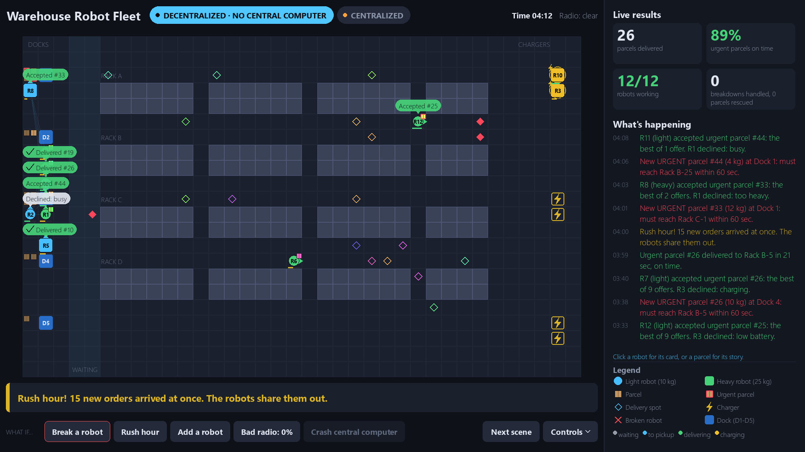

# Decentralized Swarm Logistics

**KPIT K-IMPACT 2.0 · Problem statement: Decentralized Multi-Agent Coordination for Autonomous Logistics**
Themes covered: Simulation · AI Systems · Energy · Mobility

Today's warehouse robot fleets are run by **one central computer**. If it crashes, or the Wi-Fi drops, the whole fleet stops.
This project removes the central computer. **Every robot decides for itself** and talks only to robots within radio range. Together they still behave like a well-run fleet:

- **Auctions instead of a dispatcher.** When a parcel arrives, nearby robots make offers. The best offer wins (closest, least busy, most battery to spare). Every robot applies the same rule, so they agree on the winner without a coordinator.
- **Energy-aware.** A robot only accepts a job if it can finish it and still reach a charger. If traffic drains its battery, it hands the job back. In 48 stress runs, no robot ran out of battery.
- **Self-healing.** Robots exchange "I'm alive" heartbeats. If one breaks down, a neighbour notices, and its parcel is rescued by another robot.
- **Mixed fleet and priorities.** Light robots (10 kg) and heavy robots (25 kg); urgent orders jump the queue.
- **Robust radio.** It keeps working when up to 50% of radio messages are lost.
- **Plug and play.** New robots join and start working immediately.



---

## Setup (about 2 minutes)

Requires **Python 3.10 or newer** (developed on Python 3.14, Windows 11).

```bash
pip install -r requirements.txt
```

> Use `pygame-ce`, not the older `pygame` package. If `pygame` is already installed, run `pip uninstall pygame` first, because the two packages conflict.

## Run the live demo

```bash
python run_demo.py              # fullscreen, decentralized swarm
python run_demo.py --window     # start in a window
python run_demo.py --central    # start with the centralized baseline
```

**Presenter mode:** press **N** (or **Next scene**) to step through the story:
a normal day → a robot breaks down → rush hour → bad radio → a new robot joins → the old way with one central computer → the central computer crashes → summary.

| On screen | What it does | Key |
|---|---|---|
| Break a robot | then click a robot to make it break down | B (K = random robot) |
| Rush hour | 15 orders arrive at once | O |
| Add a robot | a new robot joins the fleet | A |
| Bad radio | lose 0 / 10 / 20 / 30 / 50 % of radio messages | L |
| Crash central computer | centralized mode only | X |
| Header switch | Decentralized / Centralized | M |
| Next scene | presenter mode | N |
| Controls menu | pause, speed, follow a parcel, technical details, radio links, paths, fullscreen, reset | Space, Up/Down, I, T, C, P, F11, R |

- **Click a robot** to open its card: status, battery, current order, neighbours, and its live offers and declines.
- **Click a parcel or a dock** to see the parcel's full story and who offered to take it.
- **Esc** closes the menu or a card, then leaves fullscreen, then quits.

## Run the benchmark (graphs)

```bash
python benchmark.py             # full run, about 10-15 minutes
python benchmark.py --quick     # fast check, about 2 minutes
```

It writes three graphs to `results/`:

| Graph | Shows |
|---|---|
| `scalability.png` | Throughput, delivery time and the load on the busiest node, for 6 to 24 robots |
| `resilience.png` | Deliveries over time while robots fail and then the central computer crashes |
| `radio_loss.png` | Throughput, delivery time and failure detection at 0 to 50 % message loss |

### Key results

| | Decentralized swarm (ours) | Centralized |
|---|---|---|
| Throughput, 12–30 robots | same | same |
| Average delivery time | about 5–10 % slower | faster |
| Load on the busiest node (20 robots) | 10 msgs/tick | 20 msgs/tick |
| Deliveries after a central-computer crash (16 robots) | 129 more | 6 more, then it stops |
| 30 % radio message loss | same throughput, no stuck orders | same |
| Robots running out of battery (48 stress runs across both modes) | 0 | 0 |

**Known limit:** this floor plan (36×22 cells, 6 chargers) handles up to **30 robots**. At 40 robots the chargers and aisles become the bottleneck, and the swarm degrades before the centralized fleet does. A real deployment scales chargers and floor space with the fleet.

## Project layout

```
kpit-swarm-logistics/
├── run_demo.py          live demo (view only: it watches the simulation and explains it)
├── benchmark.py         experiments + graphs
├── swarm/
│   ├── core.py          the swarm: map, robots, auctions, energy, failure detection,
│   │                    collision avoidance, radio loss, centralized baseline
│   └── orders.py        order system (WMS): weight, priority, deadlines, place names, history
├── results/             graphs and screenshots
├── PROJECT_NOTES.md     full design notes, results, judge Q&A
└── requirements.txt
```

## From simulation to real robots

In a real warehouse, each robot would run the same logic as `swarm/core.py` on its onboard computer (Raspberry Pi or Jetson). It would sit on top of a standard navigation stack (ROS 2 Nav2) and talk to its neighbours over ROS 2 / DDS, MQTT or a Wi-Fi mesh. There is deliberately **no backend server**, because that would be the single point of failure this project removes.
The next steps would be ROS 2 + Gazebo simulation, then 2–3 small real robots, then drones or V2X vehicles using the same coordination logic.
